# IDA动态调试环境

动态调试是指把软件运行起来，通过调试器去调试软件。相比静态分析居然强大优势，我们可以实时观察内存、寄存器的变化等等。既然要运行软件，那必然要配置软件运行调试环境，IDA默认不设置debugger，但是有几个选项，如下图：

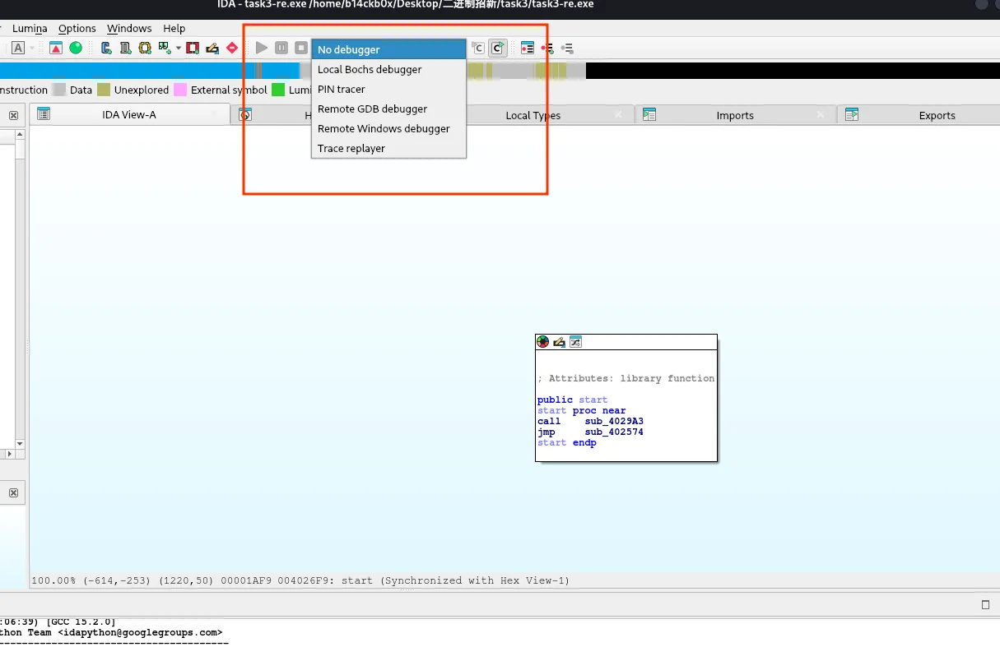

首先比较常用的是`local xxx debugger`，笔者电脑系统是linux，所以默认会有选择`local linux debugger`，这里没有是因为task3的程序是pe格式（exe程序），而不是elf，linux的本地debugger很显然不能运行windows的程序。如果各位选择在windows上用IDA调试，就能看到`local windows debugger`，选择后就能直接按旁边的播放按钮直接运行程序开始调试了。

不过调试的程序不可能总是和我们的系统一致，我们也不可能想调试什么系统的程序，就在什么系统再装一个IDA，这时候就要用到`remote xxx debugger`。

继续以我的kali系统为例，这里我想要调试task3这个windows程序，首先需要准备一个“远程”windows环境，考虑到在看本文的人可能对计算机网络完全无了解，这里简单解释一下远程的概念，IDA的远程调试指的是在远程具备相关环境的情况下调试，这里的远程环境可以是：

1.同一台电脑下运行相关环境，包括使用wine、wsl、虚拟机等形式运行的系统。比如windows用户想要调试linux程序，就可以用wsl、虚拟机等运行IDA的远程调试服务。当然无论是wsl还是虚拟机，都得确保该环境与主机不存在网络通信上的隔离，确保宿主机与其能相互访问。

2.不同电脑下，可以通过ip和端口互联的环境，比如可以在另一台电脑B上运行IDA远程调试服务器，然后把B的ip地址和端口填入当前电脑的远程环境信息，就可以使用IDA去连接电脑B，远程操控电脑B调试。

简单来说，就是远程不一定需要另一台电脑，看不懂没关系，接下来也会用我的kali演示第一种远程环境，理解了以后第二种也自然能理解。

local和remote算是最常用的了，剩下两个pin tracer和trace replayer属于高级技巧，这里先不说。

# IDA远程调试

首先，IDA为各个环境都准备了远程调试服务器，在IDA安装目录的`dbgsrv`文件夹下，如图，

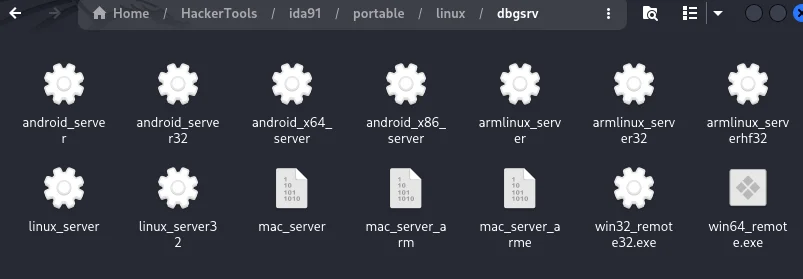

这里我需要调试windows程序，那么我需要准备一个windows系统，然后把`win32_remote32.exe`和`win64_remote.exe`两个文件复制过去。这里我准备了一个VirtualBox的windows 7系统虚拟机，虚拟机网卡选择桥接模式，可以看到桥接模式下虚拟机与宿主机同处一个局域网，能互相访问，

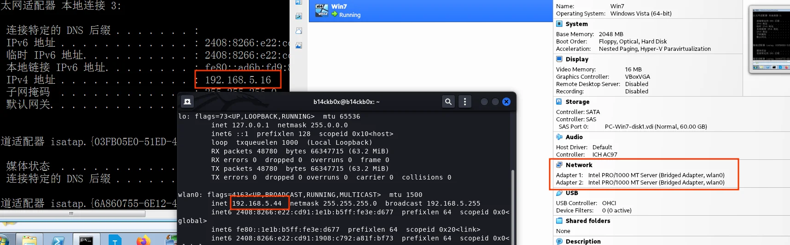

确保要调试的程序和IDA调试服务器在同一个文件夹后，运行IDA远程调试，task3是32位程序，所以这里运行了`win32_remote32.exe`，如下图。

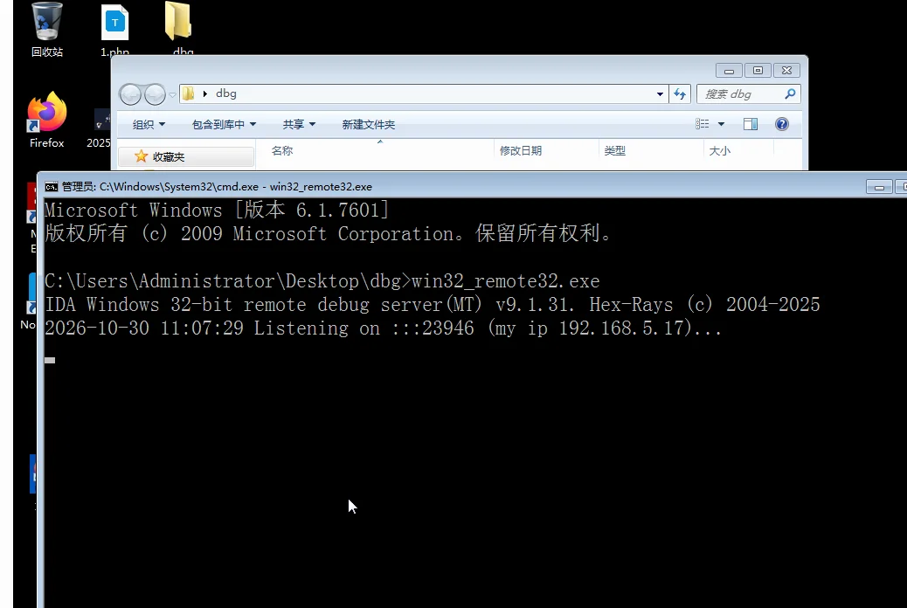

可以看到win7在23946端口开启了服务，并且贴心了打印出了当前ip是192.168.5.17，这里正常来说应该和你在ipconfig命令里看到的ip一致，但是我上一张截图是192.168.5.16，而这里却变成了17，是因为我win7配置了双网卡，所以有两个ip，前一张图的cmd再往前翻一下就能看到还有192.168.5.17这个ip（也是开了服务才想起来双网卡这事，懒得重新截图了。。。）

接下来回到我的linux机器，IDA选择`remote windows debugger`，然后就会让你填写远程主机的相关信息如下，如果wine和wsl这样非虚拟机环境的本地环境运行远程调试服务器，hostname处就可以直接填localhost，不过这里我们还是填写虚拟机ip：

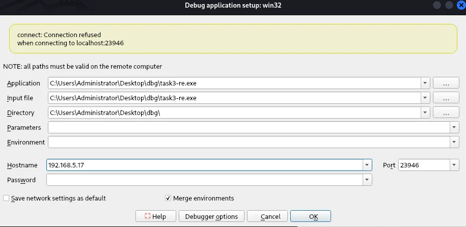

填好以后点击ok正式进入调试界面。

# 调试界面介绍

如下，正是IDA调试的界面，没什么好介绍的，很简洁一目了然，相关窗口的功能在task2的解析中有提到，虽然是gdb的，但是调试器都差不多，总不能换一个界面就看不懂了吧，不懂的回去看，这里不说了。以及无论你是通过远程调试还是本地调试，这里的界面应该是基本一样的，如果你刚刚直接选择了`local windows debugger`，那么下面你应该看到这些。

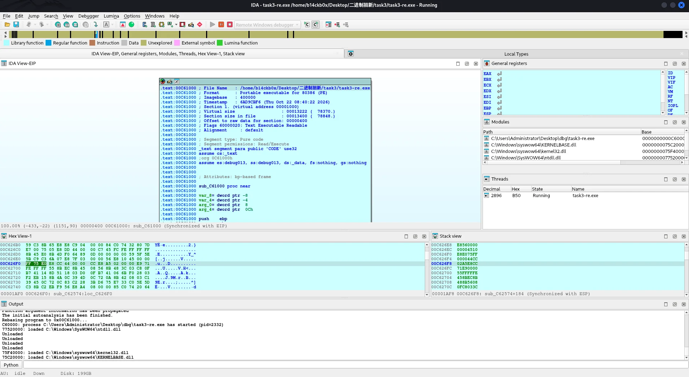

好吧顶多说一个Modules窗口，这里显示了IDA动态载入的链接库，可以看到虽然本机是linux系统，但是IDA通过win7上的远程调试服务器把windows的kernel32.dll、ntdll.dll等关键模块载入进来了。这里能载入什么取决于程序需要什么和服务器的环境有什么，换句话说如果你是用wine或者wsl，可能会因为远程环境不具备某些.dll、.so所以无法加载，这时候要注意看报错，及时换设备调试，虽然wine和wsl都集成了挺多的，但是有些程序就是会用很罕见的库，一些加密库、图形库可能并不自带，因此最好还是使用虚拟机等完整系统去调试。

还有一点是，强烈不建议用IDA调试时只看伪代码窗口或者在伪代码窗口下断点，伪代码窗口的内容来自IDA静态分析，错误通常很多，不能反应真实程序执行流程。新手喜欢把伪代码窗口当成源代码窗口，这是比较大的错误，逆向的动态调试和平时在visual studio 2022里调试程序还是很不一样的，如果有这个坏习惯一定要改。如果要看伪代码也是下面这种情况，伪代码窗口右键，选择和汇编窗口同步，这样就能看到汇编代码执行的时候对应伪代码的哪里，辅助分析。

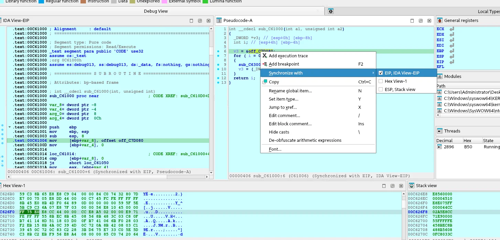

# 断点

我们刚刚运行程序的时候没有下断点，现在程序停着是因为卡在了输入

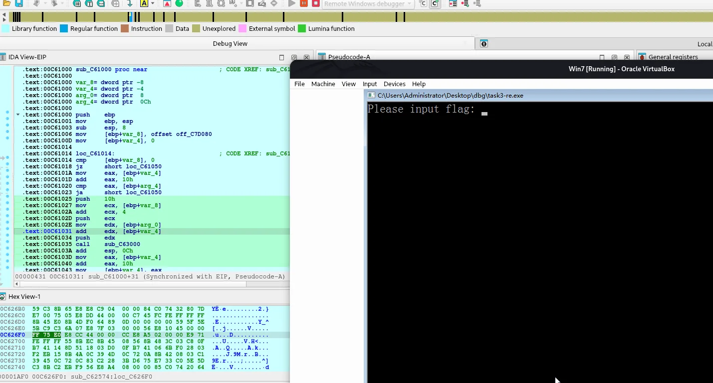

此时我们一旦随便输入点什么，程序就会继续运行到结束，IDA的动态调试也会跟着结束。如果去调试一个不等待输入的程序，就会出现刚点调试就调试结束的情况。

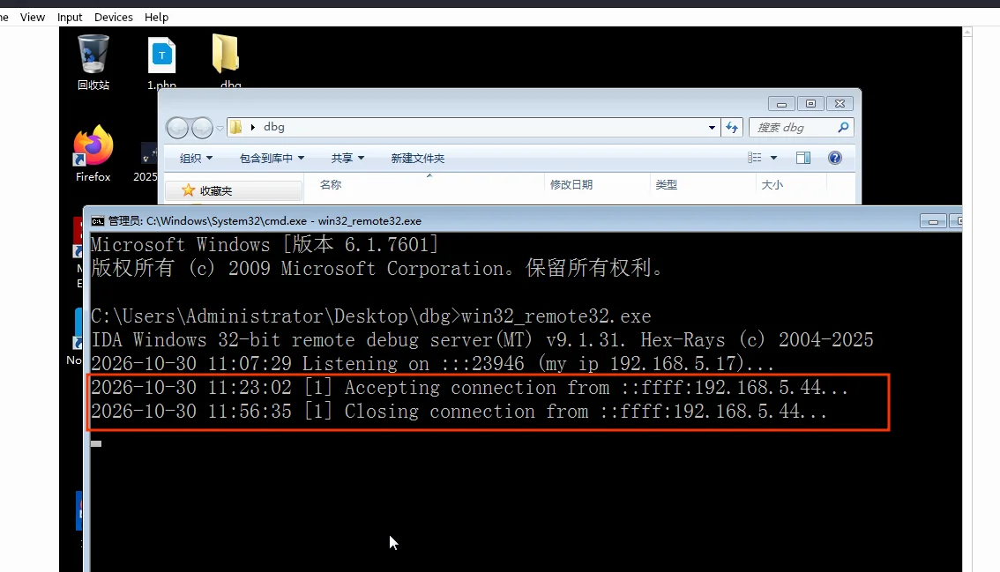

很明显这不是我们想要的，我们想要的跟踪程序运行的整个流程，所以需要下断点。

task2的解析中，我们曾经在gdb的调试刚开始时使用`b main`命令下了个main函数的断点，不过那里并没有展开断点的介绍，现在该进一步讲讲了，虽然是讲IDA的断点，但是这里的知识后续使用gdb时同样可以派上用场。

断点（Breakpoint），就是一个让程序暂停的东西，在哪里下断点，就能让程序停在那里，使程序暂停的方法有几种，也由此断点会根据不同的暂停方法来分类，不同的断点对程序执行的影响也是不同的，这里简单了解一下（讲解以x86架构为例子，不同架构断点机制会不同）。

## 软件断点

最常用、最常见的，原理是利用了CPU的断点指令，比如x86的`INT 3`，机器码`CC`所以也叫CC断点，这里的int可不是编程里的那个整数Integer，而是指操作系统里的中断Interrupt，操作系统课会学，不展开了。当程序运行到`INT 3`命令的时候会抛出异常，异常被调试器捕获，就形成了程序暂停的效果。而下软件断点本质上是：比如要在`push ebp`处下断点，那么调试器就把`push ebp`的指令直接覆盖为`int 3`，那么程序运行到`int 3`就会触发异常、中断、交由调试器处理，调试器在暂停的同时重新把指令修改回原来的`push ebp`。由此可见软件断点是会修改程序的（准确来说是进程），这在一些情况会造成问题，比如会被反调试检测，感兴趣的可以自行了解，目前只需要知道它会修改进程执行的汇编指令就行。我们一般使用调试器默认下的断点都是软件断点。

## 硬件断点

不需要替换汇编指令了，而是直接使用CPU的调试寄存器，x86架构中使用DR0~DR3四个寄存器来设置硬件断点，也就是说一般只能下四个硬件断点。除了不修改指令，硬件断点还有一大优势是可以监控读取和写入，软件断点只能针对指令的执行，对某条指令下断点，但是硬件断点能对某个内存区域下断点，只要程序试图写（Write）或者访问（Read/Write）某个被下硬件断点的内存，那么CPU就会暂停执行，抛出异常给调试器捕获。

## IDA断点设置

当然还有其它的断点类型，以及各种更复杂的条件断点，这里不拓展了。在IDA汇编界面可以点击左边的小蓝点下软件断点，或者按快捷键`F2`

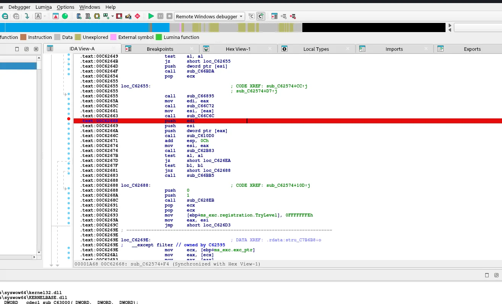

然后菜单栏Debugger->Breakpoints->Breakpoints list可以打开断点窗口，

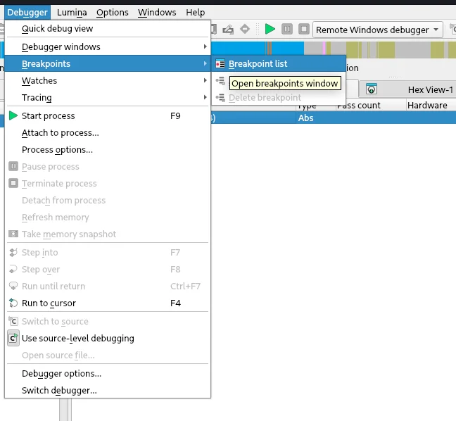

选中断点，右键可以编辑断点，给断点设置条件、转为硬件断点什么的，都可以，建议去实操了解。

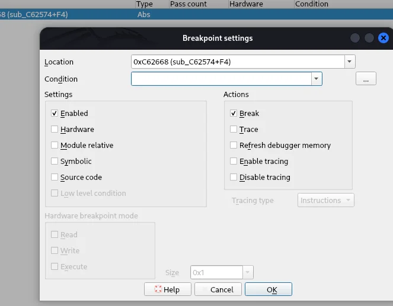

# 用动态调试解决问题

以task3为例子吧，task3实际上的代码流程是用AES算法-CBC模式解密一个数据，然后将解密数据进行MD5计算，再包上一个flag{}的外壳得到flag，同时这题还剥离了符号信息，塞入了干扰IDA静态分析的花指令。本身AES-CBC和MD5的算法实现就比较抽象，加上我加了混淆，IDA直接静态分析出来的玩意简直就是一坨，目的就是为了让大家不靠静态分析，只靠动态调试把题做出来。下面讲讲这一题可以怎么通过动态调试来做。当然，也是有办法可以静态分析出来的，AES和MD5都是标准写法，标准S盒和IV，可以通过这些特征分析出算法，然后定位到原始密文区域，用什么在线AES、在线MD5就可以做了，这里略，想挑战的自己去试试吧。

## 速通秒杀

出题之前说了动态调试可以秒杀，那当然是可以秒杀的了，这里也是群里视频的打法，最快最简单所以先介绍吧。

首先上来先用task1所说的技巧，进行字符串搜索，很快就可以看到flag相关字样，

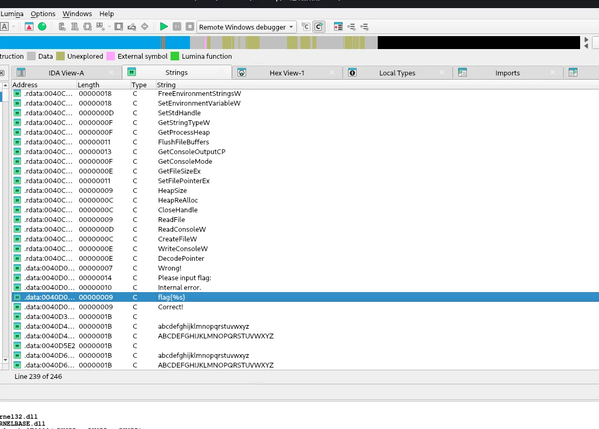

双击字符串可以跳转到汇编窗口，可以发现IDA的注释中显示字符串被`sub_3F10D0`引用，

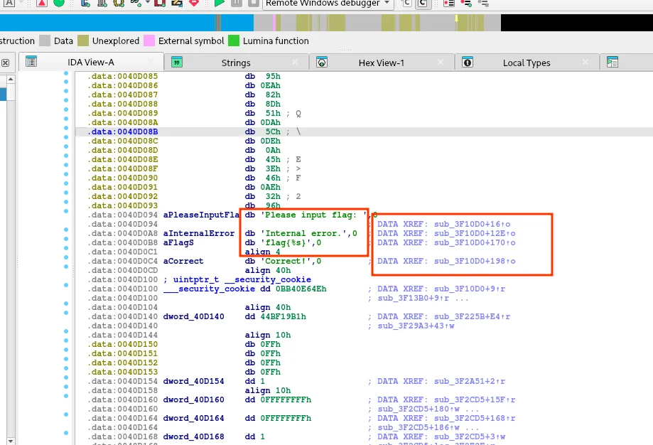

双击这个`sub_3F10D0`就可以跳转到对应的汇编代码，不难看出程序在使用strcmp来比较String1和String2的值是否相同，结合之前程序正常运行的提示，其中一个String应该是我们的输入，另一个是程序动态解出来的最终flag值，

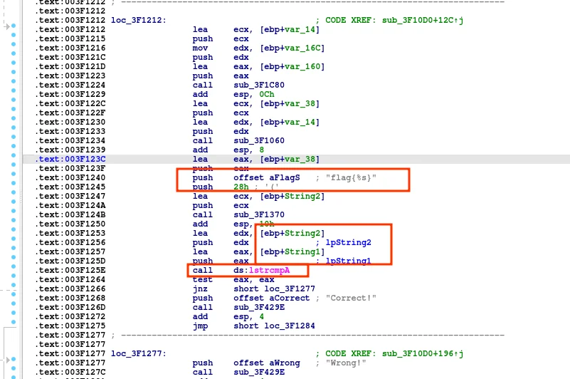

当然我们没必要判断哪个才是flag，直接在比较的指令那里下断点，再去内存里分别看看就好了

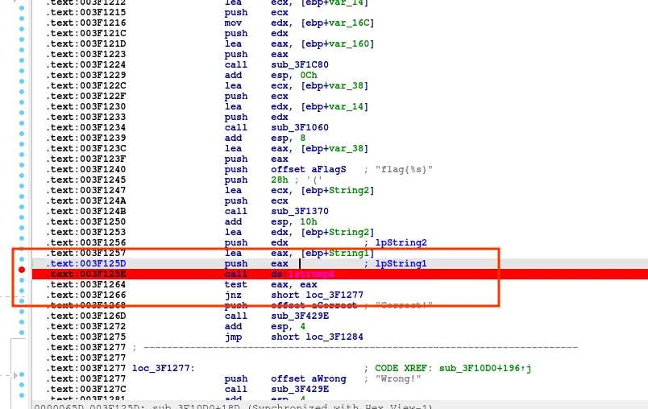

不过记得程序运行不会立刻走到我们下断点的地方，程序会因为等待输入而停下，我们需要随便输入一点什么，才能继续运行到断点。在断点停下以后随便点进String里去看看，就可以发现String2是flag了。

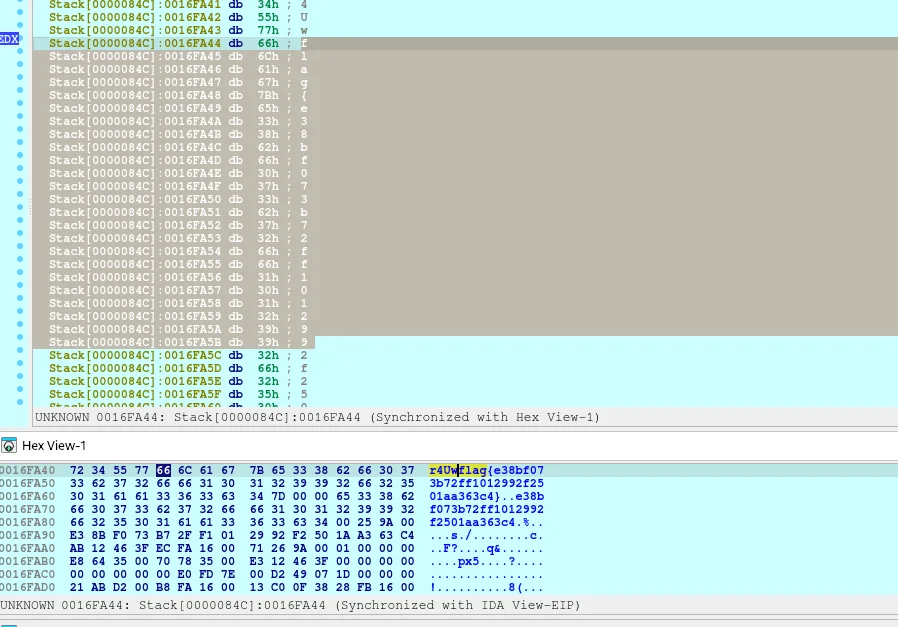

## 硬件断点监测flag

听完之前硬件断点的介绍，又看完了速通秒杀的解法，一定让你脑子有一个念头：在String2的实际内存下一处硬件断点监测读写，然后重新运行程序，这样也能直接停在flag处。（没有这个念头的该反思了，学习不会举一反三可不行啊）。那么恭喜你，你想对了。。。。。。一半吧。

String2在栈上，由于程序运行时的地址会随机化，String2的地址实际上在运行中才会确定，在IDA的静态分析界面是无法对这样一个变量下内存硬件断点的。当然，也不是说内存随机地址了，硬件断点监测内存就完全没用了。和pwn一样，我们可以通过一些“绝对”的东西来确认一些“相对”的东西，比如一种方法是，先在代码处下断点，然后动态运行，等String2的地址确定以后再对String2下硬件断点：

String2是在`sub_12C10D0`被初始化的，可以看见前面一堆var啥的，其中也包括了String2，随便在函数里下一个断点然后去看String2的值就会发现已经有东西了，不过要调试String2这块区域的话，最好还是在离修改String2近的地方下硬件断点。

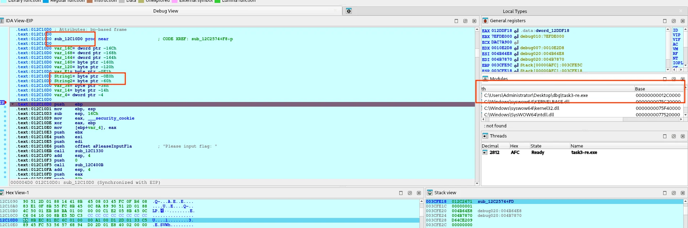

等等，函数名好像和之前看到的`sub_3F10D0`不一样了。请看右边的Modules模块，可以发现程序加载地址的基地址Base和前面的图也不一致了（没想到前面特意说一嘴Modules模块是为了这个吧），这也是因为程序动态加载导致的，每次加载的基地址都会不同，而静态分析的代码为了方便动态调试，每次动态调完也会rebase，rebase完了也会重新根据地址命名这些sub啥啥啥的函数，因此动态调试的时候有遇到重要的函数，一定要及时重新命名，不然每次调完都会变，或者就是在每次动调完后的静态分析界面`Edit → Segments → Rebase program`来重新设置基地址。

继续吧，String2有东西以后，就可以在String2下断点了，这里我下在String2开头，设置如下

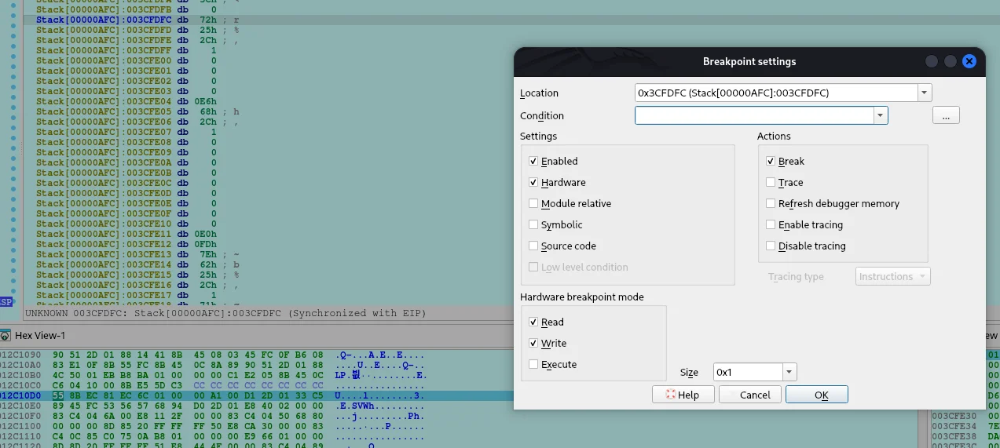

f9继续运行，发现硬件断点触发

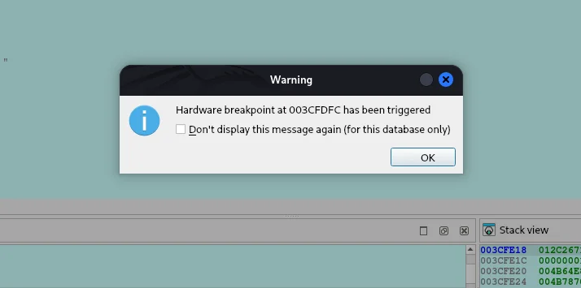

再去看栈的内容，这时候应该已经有flag的f了，不过注意断点只下在f的话，继续运行程序f后面的内容会无法看到，所以如果要检测整个flag的话，如果知道长度，可以分别首尾下一个断点，或者直接下一片内存区域比如这样（这实际上已经不是普通硬件断点而是页断点了，硬件断点不支持这样的大范围，想了解的可以自己去了解）：

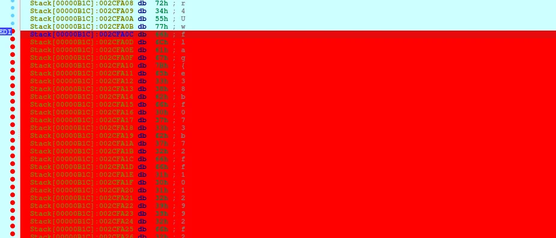

如果不知道长度也可以试试一个个硬件断点的打，调试多了也能出来。当然这题不需要这么麻烦，只是给大家一个硬件断点的调试思路。硬件断点调试内存也有其它技巧，请自行了解吧。

## 直接动调

如果没发现字符串，没有快速定位到String2，也是可以做题的，当然过程比较麻烦这里不展示了，只说大概思路：

首先通过简单运行程序我们很快能发现只是简单的flag比对，然后程序进去是start或者是main函数，就在这里随便下断点好了，接下来就一步步调，这个程序比较简单，代码全部步过就行了，很快就能步过到程序执行比对的地方。每次步过到比较有意思的函数，记得下一个断点，这样下次就可以省一点步过的时间，断点与断点之间直接用f9运行跑就完了，这样也能很快把程序跑完。笔者这题最开始就是用这样的方法调出来的，什么也没看纯靠调，大概五分钟就出来了，非常的快。

当然分析方法除了静态分析和动态调试还有很多，还有插桩、符号执行、模拟执行等，会静态分析和动态调试也只能说算是刚刚入门吧。篇幅有限，更多调试技巧还是要自己在实践中掌握。

